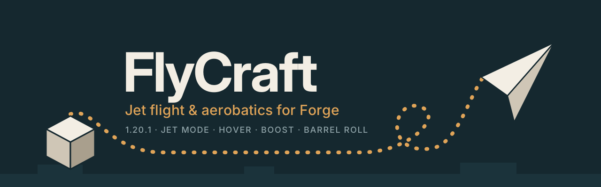

<div align="center">



<br>


**Turn the elytra into a jet.** FlyCraft adds thrust, lift and drag physics, three
keybind flight patterns, auto-detected stunts and a flight HUD to Minecraft Forge 1.20.1.

[Features](#features) · [Controls](#controls) · [Install](#install) · [Build](#build-from-source) · [How it works](#how-it-works) · [Extending](#extending-flycraft)

</div>

---

## Features

- **Jet Mode physics** — thrust along your view, lift that scales with speed, drag, banking and a stall below minimum speed. Toggle it on and off any time.
- **Flight patterns** — **Hover** to hold position, **Boost** for a 3-second burst past normal top speed, and an automated **Barrel Roll** with a matching camera spin.
- **Stunt detection** — fly sustained barrel rolls and loops on your own to earn a temporary speed bonus, with sound and particles.
- **Flight HUD** — speed bar, active pattern, boost cooldown, stunt progress, distance and flight time, plus a stall warning.
- **Cockpit camera** — the view banks into turns and shakes slightly near top speed.
- **Jet overlay** — vignette, speed lines and a G-force effect that intensify with speed.
- **Emotes** — wave, clap, dance, spin and jump animations, each with its own particle effect.

## Tutorial

<a href="./FLYCRAFT.mp4">
  
</a>

**[▶ Watch the tutorial](./FLYCRAFT.mp4)** — aerobatics and Jet Mode walkthrough (opens the video file).

| Time | Segment |
|------|---------|
| 00:00 | Intro and controls overview |
| 00:18 | Entering Jet Mode |
| 00:35 | Performing a roll |
| 00:50 | Flip / barrel roll |
| 01:10 | Combining manoeuvres and landing |

## Controls

Every key can be rebound in **Options → Controls → Key Binds → FlyCraft**.

### Flight

| Key | Action | Notes |
|:---:|--------|-------|
| `R` | Toggle Jet Mode | Needs an elytra in the chest slot |
| `G` | Hover (toggle) | Bleeds off forward speed and holds altitude |
| `H` | Boost | 3 s burst up to 1.6× top speed · 10 s cooldown |
| `J` | Barrel Roll | 1 s automated 360° roll |

Flight patterns only work while you are gliding with Jet Mode on. Landing or switching Jet Mode off cancels any active pattern.

### Emotes

| Key | Emote | Particles |
|:---:|-------|-----------|
| `V` | Wave | Sparkles |
| `C` | Clap | Burst |
| `B` | Dance (loops) | Dust cloud |
| `X` | Spin | Spiral |
| `Z` | Jump | Ring |

Emotes are easiest to see in third person (`F5`).

## Install

**Requirements:** Minecraft 1.20.1, Forge 47.4.10 or newer on 1.20.1, and a **Java 21** runtime.

1. Get `flycraft-1.0.jar` from the [Releases](https://github.com/spongebob2005/FlyCraft/releases) page, or [build it yourself](#build-from-source).
2. Put the JAR in your mods folder:
   - Windows: `%APPDATA%\.minecraft\mods\`
   - Linux / macOS: `~/.minecraft/mods/`
3. Launch the Forge 1.20.1 profile. FlyCraft appears in the Mods list with its logo.

## Build from source

```bash
git clone https://github.com/spongebob2005/FlyCraft.git
cd FlyCraft

./gradlew build        # Windows: .\gradlew.bat build
# → build/libs/flycraft-1.0.jar

./gradlew runClient    # launch a development client
```

Pushing a tag that starts with `v` (for example `v1.0`) runs the GitHub Actions workflow, which builds the JAR and attaches it to a GitHub Release.

## How it works

Every client tick while you are gliding in Jet Mode, `FlightController` computes a target velocity from the following forces, then blends 25% of the way toward it so motion stays smooth:

| Force | Behaviour |
|-------|-----------|
| Thrust | Pushes along your look direction; weaker at steep angles of attack |
| Lift | Perpendicular to velocity, grows with speed²; drops sharply past the stall angle |
| Drag | Opposes velocity, grows with speed² |
| Banking | Sideways force that makes turns feel weighted |

Speed is capped at 3.2 (5.12 while boosting). Below 0.8 you stall and start to sink unless a pattern is active. Flight patterns from `FlightPatternManager` are applied on top of these forces, and `AerobaticsManager` watches your flight path for barrel rolls and loops.

### Tuning

All the feel lives in constants at the top of two files:

| Constant | File | Default |
|----------|------|---------|
| `MAX_SPEED` | `FlightController.java` | `3.2` |
| `BASE_THRUST` | `FlightController.java` | `0.05` |
| `MIN_SPEED` (stall) | `FlightController.java` | `0.8` |
| `SMOOTHNESS` | `FlightController.java` | `0.25` |
| `BOOST_DURATION` / `BOOST_COOLDOWN` | `FlightPatternManager.java` | `60` / `200` ticks |
| `BOOST_MAX_SPEED` | `FlightPatternManager.java` | `MAX_SPEED × 1.6` |

## Project structure

```
src/main/java/com/sameeran/flycraft/
├── FlyCraftMod.java             Mod entry point and logger
├── ClientEvents.java            Key handling and Jet Mode state
├── KeybindHandler.java          Flight key registration
├── FlightController.java        Jet physics and camera
├── FlightPatternManager.java    Hover, Boost, Barrel Roll
├── AerobaticsManager.java       Stunt detection and speed bonus
├── StatsManager.java            Distance, top speed, flight time
├── HUDOverlay.java              Flight HUD
├── JetModeOverlayRenderer.java  Vignette, speed lines, G-force
├── TooltipManager.java          On-screen hints
├── JetFlightHandler.java        Fall-damage protection in Jet Mode
└── animation/                   Emote system (Animation, AnimationManager,
                                 AnimationController, easing, particles, 7 animations)

src/main/resources/
├── META-INF/mods.toml           Mod metadata
├── logo.png                     Mods-list logo
└── assets/flycraft/lang/        Key names

assets/                          Logo and banner (SVG sources + PNGs)
```

## Extending FlyCraft

Adding an emote takes five small steps.

**1. Create the animation** in `animation/`. `onUpdate` receives progress from `0` to `1`:

```java
public class SaluteAnimation extends Animation {
    private final PlayerModel<?> model;

    public SaluteAnimation(float duration, AbstractClientPlayer player, PlayerModel<?> model) {
        super(duration, false); // false = play once, true = loop
        this.model = model;
    }

    @Override
    protected void onUpdate(float progress) {
        if (model == null) return;
        float t = easeProgress(EasingFunction.Easing.EASE_OUT);
        model.rightArm.xRot = -2.4f * t;
        model.rightArm.zRot = -0.4f * t;
    }
}
```

**2. Register it** in `AnimationController.initializePlayerAnimations()`:

```java
AnimationManager.registerAnimation("salute", new SaluteAnimation(1.0f, player, model));
```

**3. Add a key** in `AnimationKeybinds` (and include it in `getAllKeybinds()`):

```java
public static final KeyMapping SALUTE_KEY = new KeyMapping(
        "key.flycraft.salute", GLFW.GLFW_KEY_N, CAT);
```

**4. Trigger it** in `ClientEvents.onKeyPress()`:

```java
if (AnimationKeybinds.SALUTE_KEY.consumeClick()) {
    AnimationController.playAnimation("salute");
}
```

**5. Name the key** in `assets/flycraft/lang/en_us.json`:

```json
"key.flycraft.salute": "Salute"
```

Available easings: `LINEAR`, `EASE_IN`, `EASE_OUT`, `EASE_IN_OUT`, `ELASTIC`, `BOUNCE`. More examples are in [ANIMATION_EXAMPLES.md](./ANIMATION_EXAMPLES.md).

## Compatibility and known limitations

- **Client-side.** Flight runs on your client. Fall-damage protection only applies in singleplayer, because the server is not told about Jet Mode.
- **Multiplayer.** Servers with anti-cheat may flag the faster movement. Ask before using it on a public server.
- **Emotes are local.** Other players do not see your animations.

Having trouble with emotes? See [ANIMATION_TROUBLESHOOTING.md](./ANIMATION_TROUBLESHOOTING.md).

## Contributing

Issues and pull requests are welcome. For bugs, include your Minecraft and Forge versions, steps to reproduce, and the relevant part of `logs/latest.log`. For changes, branch from `main`, test with `./gradlew runClient`, and describe what you changed in the pull request.

## License

FlyCraft is released under the MIT License.

## Credits

Built by **Sameeran** ([@spongebob2005](https://github.com/spongebob2005)) with Minecraft Forge. Emotes inspired by the *Actions and Stuff* mod.
